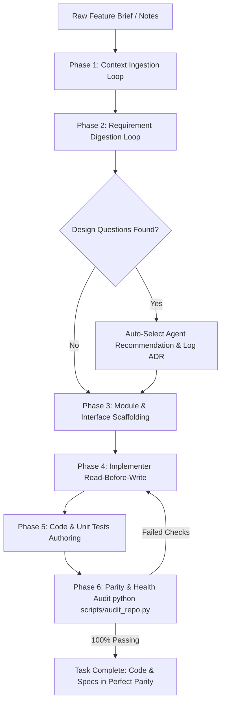

# Workflow: Autonomous Pipeline Cascade Loop

## Purpose
Explains how to run the agentic loops either as **Staged Step-by-Step Milestones** (human-in-the-loop) or as a **Fully Automated Cascade** (hands-off / overnight execution from raw notes directly to verified implementation).

---

## 1. Operating Modes: Staged vs. Autonomous Cascade

```text
┌────────────────────────────────────────────────────────────────────────┐
│ MODE A: STAGED MILESTONES (Human-in-the-Loop) - Default                │
│ Raw Notes ──► [Ingest] ──► (User Reviews Specs)                        │
│                     ──► [Digest] ──► (User Answers Design Questions)   │
│                               ──► [Implement] ──► (User Reviews Tests) │
└────────────────────────────────────────────────────────────────────────┘

┌────────────────────────────────────────────────────────────────────────┐
│ MODE B: AUTONOMOUS CASCADE (Hands-off / Overnight Execution)           │
│ Raw Notes ──► [Ingest] ──► [Digest] ──► [Auto-Resolve ADRs]            │
│                     ──► [Implement Code & Tests] ──► [100% Audit Gate] │
└────────────────────────────────────────────────────────────────────────┘
```

---

## 2. When to Use Which Mode

| Need | Recommended Mode | How to Trigger |
| :--- | :--- | :--- |
| Exploring new architecture, high-stakes decisions, or learning the codebase | **Mode A (Staged)** | Use standard step-by-step prompts (`"Ingest this context..."`, then `"Digest into tech design..."`, then `"Implement"`). |
| Well-defined feature, routine subsystem, or running overnight tasks | **Mode B (Autonomous Cascade)** | Use the `/goal` command or the Cascade Master Prompt. |

---

## 3. How the Autonomous Cascade Operates

When given an autonomous cascade directive, the agent executes the following uninterrupted chain:



---

## 4. Master Cascade Prompts

### Triggering the Autonomous Cascade in Chat
```markdown
Execute the Autonomous Pipeline Cascade for the following feature:
---
[PASTE FEATURE NOTES / PRD]
---
Directives:
1. Ingest context into docs/product/
2. Digest requirements into docs/tech/ (data schemas, API contracts, interfaces)
3. For any design questions, adopt your recommended option and record the ADR
4. Scaffold and implement the code in src/ and unit tests in tests/
5. Iterate until `python scripts/audit_repo.py` passes with a 100% health score.
```

### Overnight / Long-Running Execution with Antigravity
Use the built-in `/goal` slash command:
```text
/goal Ingest [Feature Brief], digest into technical specifications, resolve all design questions into docs/decisions/, implement all source modules and unit tests, and do not halt until `python scripts/audit_repo.py` reports 100% health.
```
