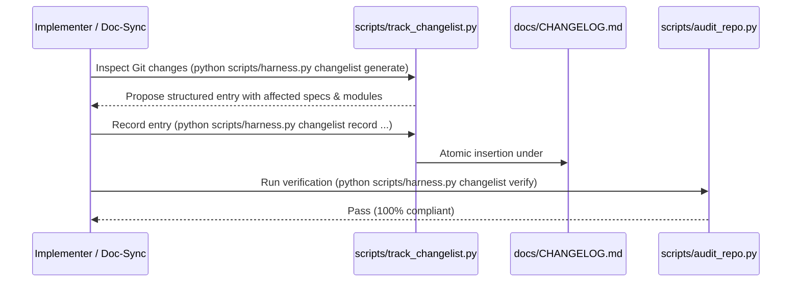

# Workflow: Changelist Tracking & Ledger Loop

## Purpose
Enforces rigorous doc-to-code traceability across all releases, milestone batches, and atomic changes by maintaining the authoritative ledger in `docs/CHANGELOG.md`.

---

## Trigger Conditions
- An agent or developer completes an implementation or doc-sync batch.
- A new product feature, API endpoint, or invariant is added or updated.
- A bug fix or security patch is committed.
- A release tag or milestone cut is prepared.

---

## Step-by-Step Execution Loop



### 1. Detect Changes & Affected Components
Run the automatic inspection utility to identify modified specs (`docs/`) and code modules (`src/`, `tests/`):
```bash
python scripts/harness.py changelist generate
```

### 2. Record Atomic Changelist Entry
Record the entry under the target version or `[Unreleased]`:
```bash
python scripts/harness.py changelist record \
  --title "Feature or Fix Title" \
  --category "Added" \
  --summary "Concise description of the change and rationale" \
  --specs "docs/tech/modules/auth/architecture.md" \
  --modules "src/auth/, tests/auth/" \
  --ref "ADR-002"
```

Valid Categories:
- `Added` (new user-facing features or capabilities)
- `Changed` (behavioral or architectural changes)
- `Fixed` (bug or edge-case fixes)
- `Invariants` (updates to non-negotiable hard rules)
- `Security` (vulnerability patches or secret hardening)
- `Deprecated` (flagged for future removal)
- `Removed` (deprecated features removed)

### 3. Verify Changelist Integrity
Ensure all entries satisfy the 4-section documentation invariants and format:
```bash
python scripts/harness.py changelist verify
```
