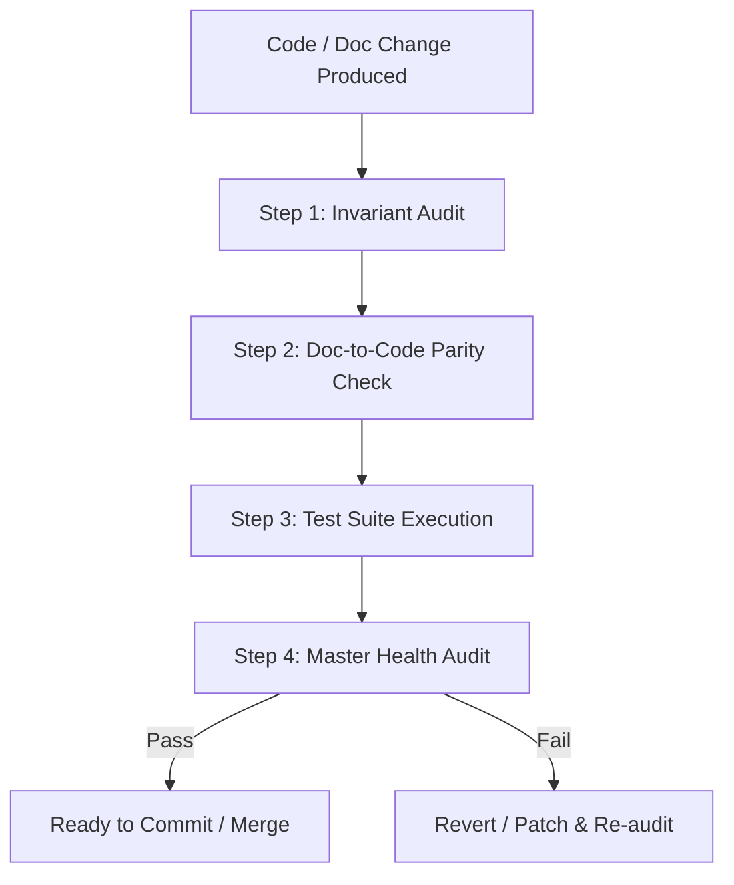

# Workflow: Autonomous Code & Doc Review Loop

## Purpose
Specifies the automated peer review criteria every agent must execute before declaring any code modification complete.

---

## 4-Step Verification Gate



### Step 1: Invariant Audit
- The reviewing agent reviews the modified code against the corresponding `## 2. Invariants` in `docs/tech/modules/<module>/architecture.md` and parent docs.
- **Fail Rule:** Any line of code violating a documented invariant triggers an immediate rejection.

### Step 2: Doc-to-Code Parity
- Run:
  ```bash
  python scripts/check_doc_drift.py
  ```
- Confirms no undocumented files exist in `src/`.

### Step 3: Test Suite Execution
- All unit, integration, and contract tests must pass with 100% success rate.
- Tests must assert invariant boundaries, edge cases, and documented error scenarios.

### Step 4: Master Health Audit
- Run:
  ```bash
  python scripts/audit_repo.py
  ```
- Ensures 100% health score across all repository standards.
