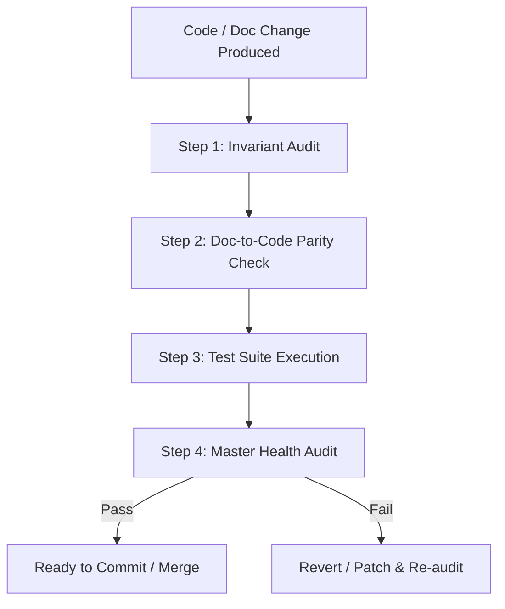

# Workflow: Autonomous Code & Doc Review Loop

## Purpose
Specifies the automated peer review criteria every agent must execute before declaring any code modification complete.

---

## 4-Step Verification Gate



### Step 1: Invariant Audit
- The reviewing agent reviews the modified code against the corresponding `## 2. Invariants` in `docs/tech/modules/<module>/architecture.md` and parent docs.
- **Fail Rule:** Any line of code violating a documented invariant triggers an immediate rejection.

### Step 2: Doc-to-Code Parity & AST Verification
- Run:
  ```bash
  python scripts/check_doc_drift.py --strict
  ```
- Confirms zero undocumented files exist in `src/` and verifies that all documented interfaces in Section 3 exist in the code AST.

### Step 3: SOLID & Code Design Review
- **SRP Check:** Does the class/module have one clear responsibility? Is pure domain logic isolated from side-effect I/O (*Functional Core, Imperative Shell*)? Are files under 400 lines and functions under 50 lines?
- **OCP Check:** Are new features added via strategy patterns or registries rather than modifying 80-line switch/if-else blocks?
- **LSP Check:** Do alternate implementations (e.g. storage adapters, audio drivers) honor identical signatures and error contracts?
- **ISP Check:** Are interfaces lean without forcing callers to supply dummy parameters?
- **DIP Check:** Are external dependencies (storage, clock, network, PRNG) injected with sane defaults rather than hardcoding global singletons (`localStorage`, `window`, `Math.random`)?
- **YAGNI Check:** Are there speculative abstractions or unused boilerplate factories? If so, simplify.

### Step 4: Test Suite Execution
- All unit, integration, and contract tests must pass with 100% success rate:
  ```bash
  python scripts/run_tests.py
  ```
- Tests must assert invariant boundaries, edge cases, and documented error scenarios.

### Step 5: Master Health Audit
- Run:
  ```bash
  python scripts/audit_repo.py
  ```
- Ensures 100% health score across all repository standards.
