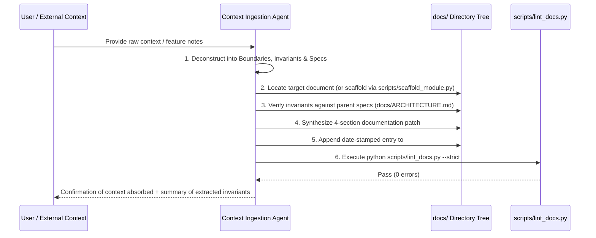

# Workflow: Context Ingestion Loop (Doc-First Context Absorption)

## Purpose
Enables an agent to receive raw, unstructured input (such as feature brainstorms, user notes, RFCs, PRDs, or meeting minutes) and cleanly absorb it into the repository's documentation tree (`docs/`) without writing premature code or violating invariants.

---

## 1. Context Triage & Routing Matrix

When raw context is provided, triage each concept into its canonical home:

| Nature of Context | Canonical Documentation Path | Blueprint Template |
| :--- | :--- | :--- |
| User journeys, personas, business value | `docs/product/overview.md` or `docs/product/domains/<domain>/requirements.md` | `templates/domain-template.md` |
| Screen transitions, state charts, edge cases | `docs/product/domains/<domain>/flows.md` | `templates/domain-template.md` |
| Database models, entity fields, migrations | `docs/tech/data/schemas.md` | `templates/leaf-template.md` |
| Cache TTL, transaction boundaries, storage | `docs/tech/data/persistence.md` | `templates/leaf-template.md` |
| REST/gRPC routes, request/response DTOs | `docs/tech/api/contracts.md` | `templates/api-contract-template.md` |
| Error codes, rate limits, retry policies | `docs/tech/api/error-handling.md` | `templates/leaf-template.md` |
| Internal module design, class signatures | `docs/tech/modules/<module>/architecture.md` | `templates/module-template.md` |
| Deployment environments, CI/CD, secrets | `docs/operations/deployment.md` | `templates/leaf-template.md` |
| Structured logs, metrics, alerts, healthz | `docs/operations/telemetry.md` | `templates/leaf-template.md` |
| Architectural trade-offs, technology choices | `docs/decisions/ADR-XXX-<title>.md` | `templates/decision-record-template.md` |

---

## 2. Step-by-Step Ingestion Cycle



### Step 1: Deconstruction
Break the raw context down into four distinct categories:
- **Boundaries:** What is explicitly owned vs. not owned?
- **Invariants:** What are the non-negotiable hard constraints? (e.g., "Must encrypt at rest", "Payload cannot exceed 2MB", "Every request must pass JWT validation").
- **Interfaces & Specs:** What are the exact schemas, DTOs, flows, or state machines?
- **Historical Revision:** What is the motivation for this context?

### Step 2: Leaf Resolution or Scaffolding
- If the domain or module already exists, locate the target leaf.
- If it is a new domain or module, invoke the built-in scaffolder:
  ```bash
  python scripts/scaffold_module.py --domain <name>
  # or
  python scripts/scaffold_module.py --module <name>
  ```

### Step 3: Invariant Synthesis
Formulate invariants as testable, hard rules. Invariants must never use weak words like "should" or "ideally"; use "must", "cannot", or "is required".

### Step 4: Atomic Patch & Decision Log
Update the target document while preserving metadata headers (`Scope:`, `Related:`). Append the revision log using:
```bash
python scripts/record_decision.py --append <target_doc> "Ingested context: <brief summary>"
```

### Step 5: Verification & Link Check
Run the linter to confirm zero structural violations or broken relative links:
```bash
python scripts/lint_docs.py --strict
```

---

## 3. Invocation Template (For Users & Agents)

To trigger this loop, prompt the agent:
> *"Ingest the following context into `docs/`: [paste raw notes or feature description]. Identify target documentation files, extract invariants, update the specs, and log the revision."*
