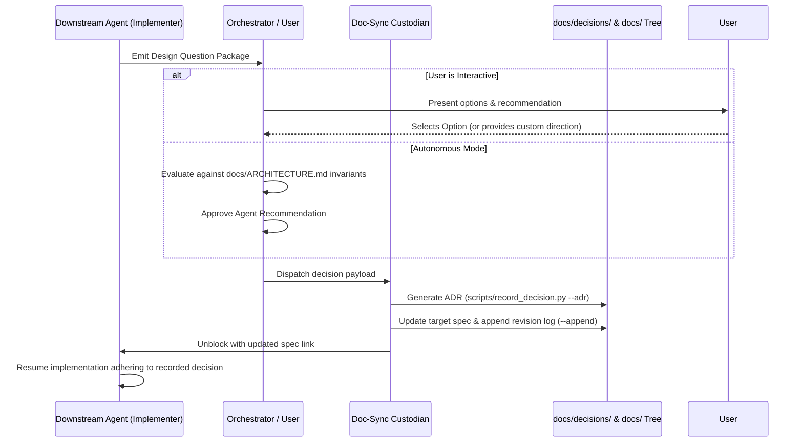

# Workflow: Design Resolution & Downstream Question Loop

## Purpose
Governs how architectural, technical, or business questions raised from downstream implementation, testing, or refactoring agents are formulated, escalated, resolved, and permanently recorded to eliminate ambiguity and prevent recurring stalls.

---

## 1. When Does This Loop Trigger?

Downstream agents must trigger this loop whenever encountering:
- **Divergent Technical Options:** Choosing between multiple valid architectures, libraries, or storage backends.
- **Ambiguous Edge Cases:** Unhandled error scenarios, missing status codes, or undefined retry policies.
- **Unspecified Data Fields:** Unclear validation constraints, nullability, or cascade behaviors.
- **Invariant Tensions:** When implementing one requirement seemingly conflicts with an invariant in another document.

---

## 2. Standard Design Question Format

When an agent raises a design question, it must never ask an open-ended question like *"What database should we use?"*. Instead, it must formulate a structured decision package:

```markdown
### ❓ [DESIGN QUESTION]: [Brief Title]

- **Originating Context:** [File path & component where question arose, e.g., `src/auth/session.py`]
- **Core Dilemma:** [Precise architectural or business ambiguity]
- **Target Specification:** [Doc file that will house the decision, e.g., `docs/tech/data/persistence.md`]

#### Evaluated Alternatives:
1. **Option A: [Name]**
   - *Pros:* [List advantages]
   - *Cons / Trade-offs:* [List drawbacks]
2. **Option B: [Name]**
   - *Pros:* [List advantages]
   - *Cons / Trade-offs:* [List drawbacks]

#### 💡 Agent Recommendation:
- **Selected Option:** Option A
- **Rationale:** [Why this aligns best with system invariants and scalability]
```

---

## 3. Resolution & Recording Sequence



---

## 4. Execution Commands for Agents

### If Major Architectural Choice (Generates ADR):
```bash
python scripts/record_decision.py --adr "Use Redis for Distributed Token Revocation" --context "Token invalidation needed for stateless JWT session management"
```

### If Contract / Parameter Specification (Appends to Document):
```bash
python scripts/record_decision.py --append docs/tech/api/contracts.md "Decided: Session tokens expire after 7 days with sliding 24-hour refresh window"
```

---

## 5. Non-Negotiable Invariants of This Loop
1. **No Silent Decisions:** Downstream agents must never make architectural or schema decisions silently in code.
2. **Single Resolution Rule:** Once a question is answered and logged in `docs/`, no future agent may reopen the question unless an explicit superseding ADR is proposed.
3. **Docs Before Code:** Implementation must pause until the decision is committed to `docs/` and validated by `scripts/lint_docs.py`.
