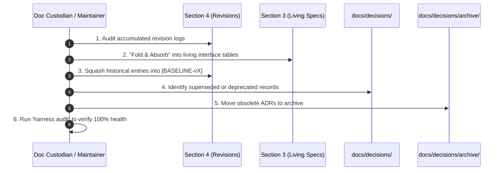

# Workflow: Documentation Compaction & Lifecycle Maintenance Loop

## Purpose
Prevents **Documentation Sclerosis**, eliminates token bloat in LLM subagent context windows, and guarantees that repository specifications remain a crisp, living representation of **Current System Reality** rather than an append-only historical log.

---

## 1. Operational Philosophy
1. **Code has Git; Documentation has Living State:**  
   Git tracks incremental history. Living documentation under `docs/` defines the *active single source of truth*. An agent reading a specification needs to know what the system does **now**, not read 40 conflicting historical iterations.
2. **Revisions & ADRs are Staging Areas:**  
   Atomic revisions in `## 4. Decisions & Revisions` and ADRs in `docs/decisions/` capture in-flight decisions. Once approved and verified in code, their contracts must be **folded into Sections 1–3** of the living specifications, and the staging logs squashed or archived.
3. **Zero Contradiction Rule:**  
   Section 4 must never contradict Section 3. If an architectural decision is recorded in Section 4, Section 3's tables and Section 2's invariants must be updated synchronously.

---

## 2. Maintenance Trigger Points
Documentation compaction must be triggered upon any of the following conditions:

| Trigger | Condition | Action |
| :--- | :--- | :--- |
| **Quantitative Threshold** | A document's Section 4 contains **> 8 revision entries**. | Squash historical revisions into a single consolidated baseline log entry. |
| **Milestone / SemVer Release** | A versioned release (`v1.0.0`, `v1.1.0`) is cut or a major roadmap phase is closed. | Consolidate all approved features into Section 3 tables; roll up `[Unreleased]` in `CHANGELOG.md`. |
| **ADR Supersedence** | An ADR is replaced by a newer architectural decision. | Mark old ADR `Status: Superseded by ADR-XXX` and move to `docs/decisions/archive/`. |
| **Token Optimization** | Subagent context pack exceeds target token budget. | Run compaction to eliminate obsolete historical clutter before agent dispatch. |

---

## 3. The 4-Step Compaction Protocol



### Step 1: Fold & Absorb into Sections 1–3
1. Read each accumulated revision in `## 4. Decisions & Revisions`.
2. Verify that every change, parameter addition, or invariant modification is explicitly written into:
   - `## 1. Responsibilities & Boundaries`
   - `## 2. Invariants (Hard Rules)`
   - `## 3. Specifications & Interfaces`
3. The specification tables in Section 3 must read as a cohesive, unified document designed cleanly from day one.

### Step 2: Squash Historical Section 4 Entries
Once Section 3 is updated, squash the accumulated bullet points into a clean baseline log entry:

```markdown
## 4. Decisions & Revisions
- 2026-10-25: [BASELINE-v1.0] Consolidated revisions 2026-08-01 through 2026-10-18 into living specifications (absorbed ADR-001 through ADR-004). Historical diffs preserved in Git.
- 2026-10-25: Current active revision.
```

### Step 3: Archive Superseded & Deprecated ADRs
1. For any ADR rendered obsolete by a subsequent decision:
   - Update frontmatter:
     ```markdown
     Status: Superseded by ADR-028
     Superseded-Date: 2026-10-25
     ```
2. Move the file into `docs/decisions/archive/`.
3. Context packers (`scripts/pack_context.py`) automatically exclude the `archive/` folder, preventing token waste and hallucinations during agent turns.

### Step 4: Audit & Health Verification
Execute full repository audit to ensure zero drift or broken links:
```bash
python scripts/harness.py compact --audit
python scripts/harness.py audit
```

---

## 4. Tooling Automation Reference

| Command | Action |
| :--- | :--- |
| `python scripts/harness.py compact --audit` | Scans all documentation and reports revision bloat and superseded ADRs |
| `python scripts/harness.py compact --threshold 8` | Identifies documents exceeding 8 revision entries |
| `python scripts/harness.py compact --squash docs/tech/modules/gateway.md` | Squashes historical Section 4 entries in target document into a consolidated baseline |
| `python scripts/harness.py compact --archive-adrs` | Moves all superseded or deprecated ADRs to `docs/decisions/archive/` |
| `python scripts/harness.py pack --domain <name>` | Automatically prunes archived ADRs and applies token-efficient Section 4 pruning |
