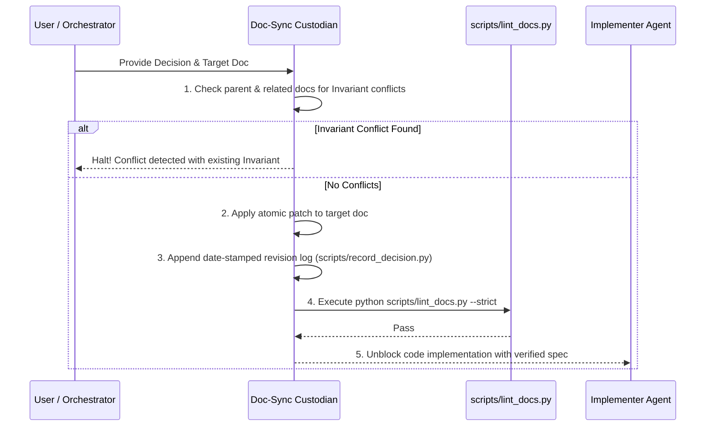

# Workflow: Doc-Sync State Synchronization Loop

## Purpose
Governs how the **Doc-Sync Custodian Agent** reconciles new design decisions, API contract modifications, or schema revisions with the single source of truth in `docs/`.

---

## Trigger Conditions
- User decides on a new business rule or API parameter.
- Implementer Agent discovers an escalation decision and requires specification updates.
- Refactoring requires altering existing interfaces or schemas.

---

## Step-by-Step Execution Loop



### 1. Invariant Conflict Check
Before editing the target document, the Doc-Sync agent must read related documents (listed in `Related:` metadata) and confirm that the change does not break existing `## 2. Invariants`.

### 2. Atomic Documentation Patch
Apply modifications directly to `## 3. Specifications & Interfaces`. Do not touch untouched sections.

### 3. Record Decision Log
Append the decision log entry to `## 4. Decisions & Revisions`:
```bash
python scripts/record_decision.py --append <target_file> "<Description of change>"
```

### 4. Self-Lint Validation
Run the documentation linter to ensure no broken headers or links were introduced:
```bash
python scripts/lint_docs.py --strict
```

### 5. Handoff to Implementer
Once linting passes with exit code 0, notify the Implementer Agent that the specification is locked and code production may safely proceed.
