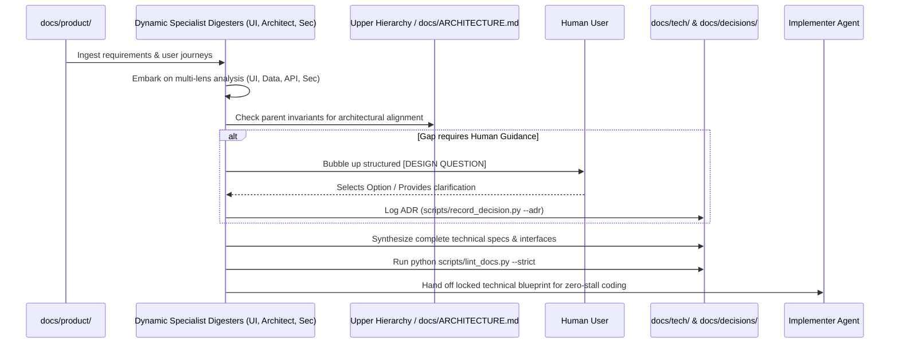

# Workflow: Requirement-to-Design Digestion Loop

## Purpose
Bridges the critical gap between **Product Requirements** (`docs/product/`) and **Technical Architecture** (`docs/tech/`). 
It empowers the agent to embody **dynamic specialist lenses** (e.g., System Architect, UI/UX Specialist, Security Specialist, DevOps Engineer) to digest requirements into concrete technical contracts, and **proactively surfaces design questions up the hierarchy or to the user BEFORE writing any code**.

---

## 1. Dynamic Specialist Digestion Lenses

Depending on the nature of the requirements, the agent dynamically assumes the necessary specialist perspectives to digest requirements into the appropriate documentation leaves:

| Specialist Lens | Focus Area & Digestion Output | Target Documentation Leaves |
| :--- | :--- | :--- |
| 🏛️ **System Architect** | Data persistence models, transactional boundaries, subsystem module decomposition, and dependency graphs. | `docs/tech/data/`, `docs/tech/modules/<module>/` |
| 🎨 **UI/UX Specialist** | Component state charts, interaction flows, accessibility invariants, optimistic UI updates, and responsive breakpoints. | `docs/product/domains/<domain>/flows.md`, `docs/tech/modules/ui/` |
| 🔒 **Security Specialist** | AuthN/AuthZ mechanisms, RBAC roles, encryption at rest/in transit, secret management, and threat modeling. | `docs/tech/api/contracts.md`, `docs/operations/deployment.md` |
| ⚡ **API & Protocols Specialist** | REST/gRPC/WebSocket payloads, error envelopes, versioning strategies, rate limits, and pagination contracts. | `docs/tech/api/contracts.md`, `docs/tech/api/error-handling.md` |
| 🚀 **DevOps & SRE Specialist** | Target environments, CI/CD pipeline stages, container constraints, structured logging formats, and health probe contracts. | `docs/operations/deployment.md`, `docs/operations/telemetry.md` |

---

## 2. The Hierarchical Question Escalation Ladder

Specialists must never guess answers to cross-cutting dilemmas. Instead, questions follow a **3-Tier Hierarchical Escalation Ladder**:

```mermaid
graph TD
    Specialist([Specialist Digester Identifies Dilemma]) --> Tier1{Tier 1: Parent Invariants Check}
    Tier1 -- Resolved by docs/ARCHITECTURE.md --► AutoResolve1[Resolve & Record under ## 4]
    Tier1 -- Unresolved --► Tier2{Tier 2: Cross-Specialist / Lead Architect Alignment}
    Tier2 -- Resolvable from System Constraints --► AutoResolve2[Generate ADR & Update Specs]
    Tier2 -- Unresolved Business / Product Fork --► Tier3[Tier 3: Escalate to Human User]
    Tier3 --> DecisionPackage[Emit Structured [DESIGN QUESTION] Package]
    DecisionPackage --> UserPick([User Selects Direction or Provides Input])
    UserPick --> LogADR[Record ADR via python scripts/record_decision.py]
    LogADR --> Resume([Proceed with Technical Blueprint])
```

### Tier 1: Upper Documentation Hierarchy Check
The specialist checks `docs/ARCHITECTURE.md` and parent domain overviews. If a global constraint (e.g., *"All public services must remain stateless"*) already decides the question, the specialist applies the rule without stalling.

### Tier 2: Cross-Specialist Alignment (Lead Architect Resolution)
If a UI specialist asks: *"Should we use WebSocket streaming or HTTP polling for live status?"*, the agent's System Architect lens checks backend scalability invariants. If WebSocket is required to meet the 500ms latency invariant, the question is answered internally, logged in the decision revision log, and design proceeds.

### Tier 3: Human User Escalation
If the question represents a **fundamental product direction, external vendor choice, or user experience trade-off** that cannot be derived from existing documentation, the specialist halts and formulates a **Decision Package**:

```markdown
### ❓ [DESIGN QUESTION from UI Specialist]: Real-Time Feed Delivery

- **Originating Context:** docs/product/domains/notifications/flows.md
- **Core Dilemma:** How should incoming notifications be presented to the user?
- **Target Specification:** docs/tech/modules/notifications/architecture.md

#### Evaluated Alternatives:
1. **Option A: Optimistic Push via WebSockets (Recommended by UI Specialist)**
   - *Pros:* Immediate user feedback, zero manual refreshes.
   - *Cons:* Requires maintaining persistent WebSocket connections on backend.
2. **Option B: Periodic Polling (30s interval)**
   - *Pros:* Simpler server infrastructure; stateless HTTP.
   - *Cons:* Notification latency up to 30 seconds; extra battery/network usage on mobile.

#### 💡 Specialist Recommendation:
Option A &mdash; Delivers modern real-time experience matching core product vision.
```

---

## 3. Step-by-Step Digestion Sequence



### 4. Technical Blueprint Locking
Once all specialist perspectives have completed digestion and all questions are closed in `docs/decisions/`, the specification is locked:
```bash
python scripts/lint_docs.py --strict
```
The Implementer agent now possesses complete, unambiguous contracts across UI, backend, data, and security before writing a single line of application code.
