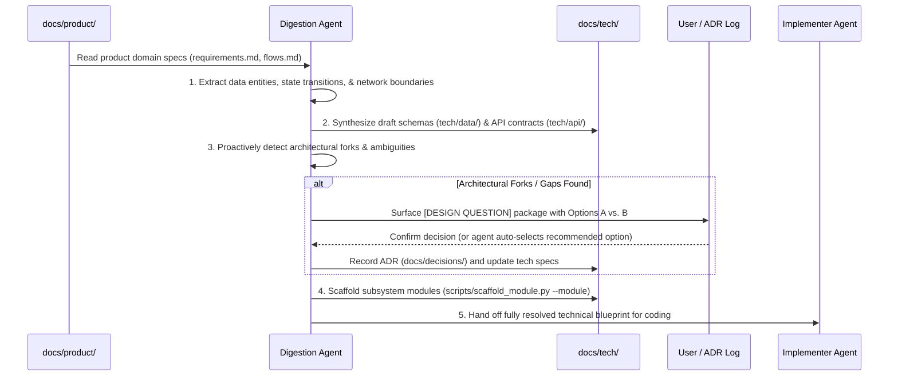

# Workflow: Requirement-to-Design Digestion Loop

## Purpose
Bridges the critical gap between **Product Requirements** (`docs/product/`) and **Technical Architecture** (`docs/tech/`). 
It analyzes business requirements, translates them into technical contracts (schemas, APIs, interfaces), and **proactively surfaces design questions BEFORE any code is written**.

---

## The 3-Tier Digestion Architecture

```text
┌─────────────────────────────────┐
│ 1. Product Requirements         │ (User stories, acceptance criteria, interaction flows)
│    docs/product/domains/        │
└────────────────┬────────────────┘
                 │
                 ▼  [Requirement Digestion Loop]
┌─────────────────────────────────┐
│ 2. Technical Architecture       │ (Data models, API contracts, interface signatures)
│    docs/tech/data/ & api/ & mod/│
└────────────────┬────────────────┘
                 │
                 ▼  [Design Questions Surfaced Proactively]
┌─────────────────────────────────┐
│ 3. ADRs & Decision Closure      │ (Resolved trade-offs, locked contracts)
│    docs/decisions/              │
└────────────────┬────────────────┘
                 │
                 ▼  [Implementer Handoff]
┌─────────────────────────────────┐
│ 4. Code & Unit Test Execution   │ (Pristine, 100% adherence to specifications)
│    src/ & tests/                │
└─────────────────────────────────┘
```

---

## Step-by-Step Digestion Sequence



### 1. Requirements Ingestion & Decomposition
Read the product requirements and break them down into:
- **Entities & Relationships:** What nouns exist? What are their lifecycles? (Maps to `docs/tech/data/schemas.md`).
- **External Interfaces:** How do clients or services interact? (Maps to `docs/tech/api/contracts.md`).
- **Operational Boundaries:** What are the throughput, latency, or security constraints? (Maps to `docs/operations/`).

### 2. Technical Synthesis (Pre-Code Specifications)
Create or update technical specifications:
- Define database models, fields, and constraints.
- Define HTTP/gRPC routes, request bodies, and error response envelopes.
- Define exported TypeScript/Python interfaces and method signatures.

### 3. Proactive Design Question Discovery
Before handing off to the Implementer, the agent scans for technical forks:
- *Storage dilemma:* Relational vs. Document vs. Key-Value?
- *State dilemma:* In-memory vs. Distributed Cache?
- *Error dilemma:* How are validation failures structured?
- *Concurrency dilemma:* Optimistic locking vs. Pessimistic locking?

Each dilemma is packaged using the **[DESIGN QUESTION]** format defined in [design_resolution_loop.md](file:///d:/Workspace/AiTeam/.agent/workflows/design_resolution_loop.md).

### 4. Technical Blueprint Locking
Once design questions are resolved and recorded in `docs/decisions/`, run:
```bash
python scripts/lint_docs.py --strict
```
The blueprint is now locked. The Implementer can write code with **zero ambiguity and zero stalls**.
