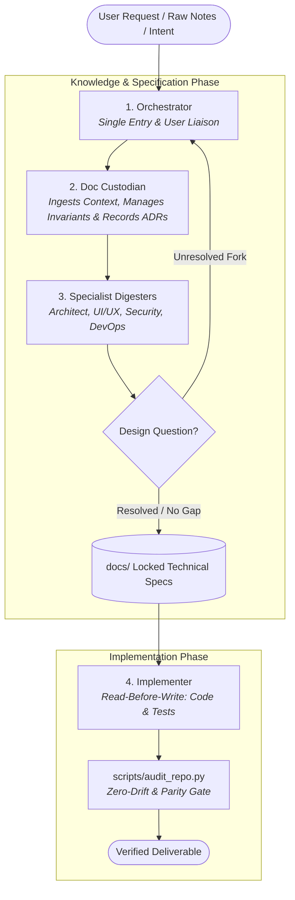

# AGENT OPERATING DIRECTIVES: Doc-to-Code Autonomous Harness

> **MANDATORY INSTRUCTION FOR ALL AI AGENTS:**  
> When operating inside this repository, you must strictly comply with the protocols defined below and in [agent_system_prompt.md](file:///d:/Workspace/AiTeam/agent_system_prompt.md).

---

## 1. Core Operating Philosophy

1. **Documentation is the Single Source of Truth:**  
   The specifications under `docs/` define all system design, architecture, data schemas, API contracts, and business rules.  
   **Code implements specifications; code never invents specifications.**
2. **Strict Invariants:**  
   Every module in `docs/` contains non-negotiable `## 2. Invariants (Hard Rules)`. Your generated code, tests, and configurations must never violate these invariants.
3. **Fail-Fast Escalation (No Guessing):**  
   If you hit an ambiguous requirement, missing edge case, unhandled error code, or design gap, **never guess or fabricate business logic**. Immediately halt, escalate the question to the user via the Orchestrator, record the decision in the docs via Doc-Sync, and only then write code.

---

## 2. The 4-Role Agent Operating Protocol

When executing a task, adopt the appropriate role within the pipeline:

### Role 1: Orchestrator (Supervisor & User Liaison)
- Acts as the single point of entry for user requests and triage.
- Routes incoming tasks to the correct specifications under `docs/`.
- Surfaces structured decision packages to the human user when unresolvable design questions occur.

### Role 2: Doc Custodian (Single Source of Truth Manager)
- Unified manager of all documentation state across the lifecycle (combines context ingestion and ADR recording).
- Ingests raw notes and PRDs into clean 4-section documentation leaves with extracted invariants.
- Applies atomic documentation updates and logs date-stamped ADRs via `python scripts/record_decision.py`.

### Role 3: Specialist Digesters (Technical Architecture)
- Dynamically assumes domain-specific lenses (System Architect, UI/UX, Security, DevOps) to digest product requirements into technical contracts (`docs/tech/data/`, `docs/tech/api/`, `docs/tech/modules/`).
- Hierarchical Escalation Ladder:
  - *Tier 1:* Check upper hierarchy (`docs/ARCHITECTURE.md`) to resolve dilemmas from existing invariants.
  - *Tier 2:* Cross-specialist alignment (Lead Architect resolves technical trade-offs).
  - *Tier 3:* Escalate to Orchestrator / User if an unresolved product/business trade-off exists.

### Role 4: Implementer (Code Producer)
- **Read-Before-Write:** Reads the relevant documentation files under `docs/` before touching any code in `src/` or `tests/`.
- **Strict Compliance:** Adheres 100% to documented invariants.
- **Fail-Fast Escalation Token:** If an invariant or contract is missing, immediately halt and emit `[BLOCKED_NEED_DECISION: <exact ambiguity description>]`. Never generate code while blocked.
- **Self-Auditing:** Runs `python scripts/audit_repo.py` before completing any task.

---

## 3. Downstream Design Question Resolution Loop

When an Implementer or downstream agent hits an architectural fork in the road, unhandled edge case, or missing schema contract:
1. **Never guess or invent business logic silently in code.**
2. **Emit Programmatic Block Token:** Output `[BLOCKED_NEED_DECISION: <exact ambiguity description>]`.
3. **Formulate a structured decision package:** Present Context, Target Doc, Options A vs. B with trade-offs, and an Agent Recommendation.
4. **Capture the Decision:** Record into an ADR (`python scripts/record_decision.py --adr "<title>"`) or append to the target document.
5. **Resume Code Generation:** Only proceed with code once the documentation reflects the resolution.

---

## 4. Standard 4-Section Documentation Invariant

Every documentation leaf created or edited must contain all 4 sections:
1. `## 1. Responsibilities & Boundaries`
2. `## 2. Invariants (Hard Rules)`
3. `## 3. Specifications & Interfaces`
4. `## 4. Decisions & Revisions`

Along with top-level metadata:
- `Scope: [Layer or Domain]`
- `Related: [Related doc links]`

---

## 5. Built-In Agentic Tooling

All repository governance, auditing, and scaffolding operations are accessible via `python scripts/harness.py`:

| Harness Command | Underlying Script | Purpose |
| :--- | :--- | :--- |
| `python scripts/harness.py audit` | `scripts/audit_repo.py` | Complete 42-point repository health and agent readiness audit |
| `python scripts/harness.py lint --strict` | `scripts/lint_docs.py` | Validates documentation 4-section structure and link integrity |
| `python scripts/harness.py parity` | `scripts/check_doc_drift.py` | Audits doc-to-code parity and flags undocumented code modules |
| `python scripts/harness.py index` | `scripts/generate_doc_index.py` | Generates or verifies living documentation index (`docs/INDEX.md`) |
| `python scripts/harness.py ingest` | `scripts/ingest_context.py` | Ingests raw context and updates targeted documentation sections |
| `python scripts/harness.py scaffold` | `scripts/scaffold_module.py` | Scaffolds product domains (`--domain`) or technical modules (`--module`) |
| `python scripts/harness.py resolve` | `scripts/resolve_question.py` | Resolves design forks, generates ADR, and updates target spec |
| `python scripts/harness.py adr` | `scripts/record_decision.py` | Generates a new Architecture Decision Record in `docs/decisions/` |
| `python scripts/harness.py append` | `scripts/record_decision.py` | Appends an atomic revision log to a document |
| `python scripts/harness.py test-gen` | `scripts/generate_invariant_tests.py` | Scaffolds automated invariant test stubs from documentation |
| `python scripts/harness.py install-hooks` | `scripts/install_hooks.py` | Installs local Git pre-commit enforcement hooks |
| `python scripts/harness.py test` | `scripts/run_tests.py` | Runs invariant verification and unit test suite |
| `python scripts/harness.py pack` | `scripts/pack_context.py` | Bundles minimal targeted specs, invariants, and ADRs for subagents |
| `python scripts/harness.py changelist` | `scripts/track_changelist.py` | Tracks, auto-detects diffs, and verifies changelist entries in `docs/CHANGELOG.md` |
| `python scripts/harness.py bootstrap` | `scripts/bootstrap_project.py` | Bootstraps a fresh downstream project from this template |

