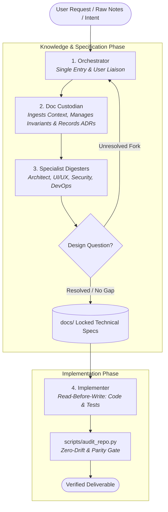
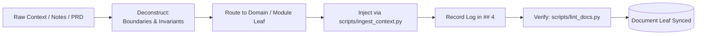
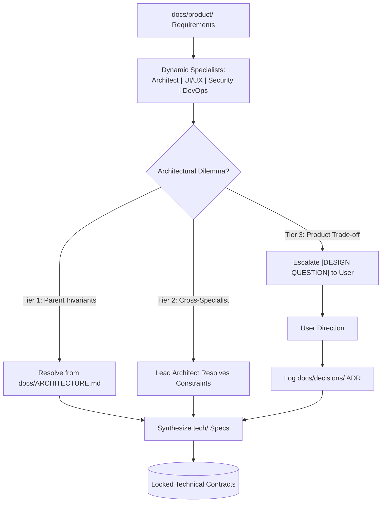
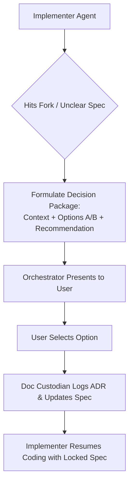
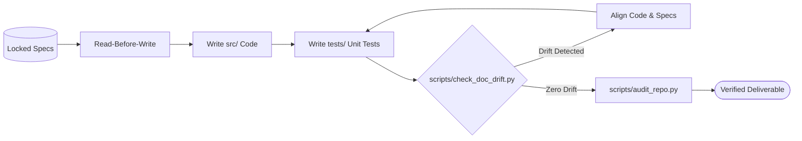
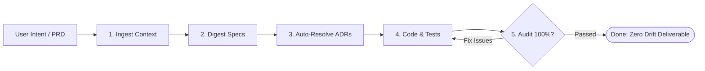

# 🚀 Doc-to-Code Autonomous Harness: Pristine Agentic Meta-Generator

> **The zero-application-code repository template engineered to bootstrap any software project with strict doc-to-code parity, autonomous agent personas, fail-fast escalation protocols, and continuous documentation health linters.**

[](scripts/audit_repo.py)
[-blue.svg)](scripts/)
[](templates/leaf-template.md)
[](AGENTS.md)
[](LICENSE)

---

## 🌟 1. Core Philosophy: Why This Template?

In modern software engineering with AI coding assistants (Google Antigravity, Cursor, Claude Code, GitHub Copilot), development frequently collapses under three failure modes:
1. **Hallucinated Business Logic:** Agents silently guess unhandled edge cases, error codes, and business rules in code.
2. **Architectural Drift:** Implementation drifts away from PRDs and design docs until documentation becomes obsolete fiction.
3. **Ghost Code:** Features, tables, and endpoints are created with zero matching tests or contracts.

### The Invariant Paradigm
```text
┌─────────────────┐      ┌───────────────────────────┐      ┌─────────────────────────┐
│   User Intent   │ ───► │  docs/ (Single Truth)     │ ───► │ src/ & tests/           │
│  & Raw Context  │      │  Strict 4-Section Specs   │      │ (Implements Specs Only) │
└─────────────────┘      └───────────────────────────┘      └─────────────────────────┘
                                       ▲
                        [ESCALATE ON AMBIGUITY]
                         Never Guess In Code!
```

> **Fundamental Directives:**
> 1. **Documentation is the Single Source of Truth:** Specifications under `docs/` define all architecture, interfaces, and invariants. **Code implements specifications; code never invents specifications.**
> 2. **Strict Invariants:** Every module defines non-negotiable rules under `## 2. Invariants (Hard Rules)` that generated code must never violate.
> 3. **Fail-Fast Escalation:** If an agent encounters an unhandled edge case or design gap, it must halt, formulate a decision package, record the user's decision in `docs/`, and only then produce code.

---

## ⚡ 2. Quick Start: Zero to First Feature in 5 Minutes

### Step 1: Use This Template on GitHub
Click **"Use this template"** > **"Create a new repository"** to spin up your project repository.

### Step 2: Clone & Initialize
Open your terminal in your local project workspace:
```bash
# 1. Initialize your project metadata and git repository
python scripts/harness.py bootstrap --name "my-awesome-service" --description "High throughput event processing platform"

# 2. Verify pristine template health (42-point audit)
python scripts/harness.py audit
```

### Step 3: Launch in Your Agentic IDE
Open the workspace in **Google Antigravity**, Cursor, Claude Code, or VS Code (or 1-click in GitHub Codespaces via `.devcontainer/`).

### Step 4: The Agent Kickoff Prompt (Copy & Paste)
Give this prompt to your AI coding agent to begin your project:
```markdown
Read `AGENTS.md`, `agent_system_prompt.md`, and `docs/ARCHITECTURE.md`. 
We are building [Describe your project, e.g., 'a distributed notification gateway with SMS and email providers'].
Act as Role 1 (Orchestrator) and Role 2 (Doc Custodian) to absorb this vision, establish our product overview in docs/product/overview.md, and scaffold our first domain.
```

---

## 🤖 3. The 4-Role Agent Operating Protocol

When operating in this codebase, AI agents switch between four cleanly separated roles across the design and implementation lifecycle:



| Role | Core Accountability | Primary Operating Directive |
| :--- | :--- | :--- |
| **1. Orchestrator** | **Supervisor & Interface** | Single entry point. Triages requests, routes to specs, and escalates unresolved trade-offs to the user. |
| **2. Doc Custodian** | **Single Source of Truth Manager** | Absorbs raw context, verifies invariant compatibility, applies atomic doc patches, and logs ADRs. |
| **3. Specialist Digesters** | **Technical Architecture** | Assumes specialist lenses (Architect, UI/UX, Security, DevOps) to turn product requirements into schemas, APIs, and design questions. |
| **4. Implementer** | **Code & Test Producer** | **Read-Before-Write.** Reads locked specs, writes application code and unit tests, and self-audits before completing tasks. |

---

## 🔄 4. The Core Agentic Lifecycles (Walkthroughs & Diagrams)

### Lifecycle A: Ingesting Context into Docs ("Just Add Context")
*Workflow Reference:* [.agent/workflows/context_ingestion_loop.md](file:///d:/Workspace/AiTeam/.agent/workflows/context_ingestion_loop.md)

When you have unstructured thoughts, user stories, or architecture notes, you don't need to manually write markdown specifications. Simply feed the raw context to the agent:



```text
User: "Here are my notes for user billing: We need to support Stripe and PayPal. All subscription payments 
must be retried 3 times with exponential backoff before canceling. Webhooks must be verified with HMAC SHA-256."
```

**What the Agent Does Autonomously:**
1. **Deconstructs:** Isolates boundaries, invariants ("Retries capped at 3", "HMAC SHA-256 verification mandatory"), and interfaces.
2. **Scaffolds / Updates:** Runs `python scripts/scaffold_module.py --domain billing` or updates `docs/product/domains/billing/`.
3. **Injects Specifications:** Uses `python scripts/ingest_context.py` to populate `## 2. Invariants` and `## 3. Specifications`.
4. **Logs Revision:** Appends a date-stamped entry under `## 4. Decisions & Revisions`.
5. **Verifies:** Executes `python scripts/lint_docs.py --strict` to guarantee zero broken links.

---

### Lifecycle B: Dynamic Specialist Digestion & Hierarchical Questions
*Workflow Reference:* [.agent/workflows/requirement_digestion_loop.md](file:///d:/Workspace/AiTeam/.agent/workflows/requirement_digestion_loop.md)



Product requirements can be digested by the agent using **whatever specialist lens fits best**:
- 🏛️ **System Architect:** Translates user stories into relational/document data models (`docs/tech/data/`) and subsystem decomposition (`docs/tech/modules/`).
- 🎨 **UI/UX Specialist:** Derives user interaction sequences, component state machines, optimistic UI updates, and responsive breakpoints.
- 🔒 **Security Specialist:** Formulates authentication/authorization policies, RBAC roles, encryption at rest/in transit, and threat mitigations.
- 🚀 **DevOps & SRE:** Derives environment tiers, health probe endpoints (`/healthz`, `/ready`), and structured JSON logging schemas.

#### The 3-Tier Hierarchical Question Ladder:
When a specialist encounters an unhandled dilemma:
1. **Tier 1 (Upper Documentation Hierarchy):** Can the dilemma be solved by constraints already in `docs/ARCHITECTURE.md`? If yes, apply the rule and record the revision.
2. **Tier 2 (Cross-Specialist Alignment):** Can the Lead Architect or System Specialist resolve the UI/data dilemma based on documented performance invariants? If yes, resolve and generate an ADR.
3. **Tier 3 (Human User Escalation):** If it represents an unresolvable business/product trade-off, bubble it up to the human user as a structured **`[DESIGN QUESTION]`** package with Option A vs. Option B and an agent recommendation.

---

### Lifecycle C: Answering Downstream Design Questions ("Design Resolution")
*Workflow Reference:* [.agent/workflows/design_resolution_loop.md](file:///d:/Workspace/AiTeam/.agent/workflows/design_resolution_loop.md)



When an implementer agent is writing code and hits an architectural fork in the road (e.g., PostgreSQL vs. MongoDB, error code format, or rate limiting headers), **it is forbidden from guessing silently in code**.

**The Agent Halts and Emits a Structured Decision Package:**
```markdown
### ❓ [DESIGN QUESTION]: Distributed Session Invalidation

- **Originating Context:** src/auth/token_service.py
- **Core Dilemma:** We need to invalidate JWT tokens on user logout, but JWTs are stateless.
- **Target Specification:** docs/tech/data/persistence.md & docs/tech/api/contracts.md

#### Evaluated Alternatives:
1. **Option A: Redis Token Denylist with Sliding TTL (Recommended)**
   - *Pros:* High throughput (O(1)), automatic key expiry matches JWT expiration.
   - *Cons:* Adds Redis dependency to session verification path.
2. **Option B: Database Token Revocation Table with Periodic Purge**
   - *Pros:* No new infrastructure; uses existing relational database.
   - *Cons:* Additional database read on every authenticated API request.

#### 💡 Agent Recommendation:
Option A &mdash; Preserves sub-10ms API latency requirements defined in docs/tech/overview.md.
```

**Resolution Flow:**
1. The user responds: *"Option A"*.
2. The Doc Custodian runs:
   ```bash
   python scripts/record_decision.py --adr "Use Redis for Distributed Token Revocation" --context "Stateless JWT logout requires real-time denylist"
   ```
3. Target specs are updated with the Redis contract.
4. The Implementer resumes coding and writing unit tests against the locked contract.

---

### Lifecycle D: Implementation & Continuous Parity
*Workflow Reference:* [.agent/workflows/code_review_loop.md](file:///d:/Workspace/AiTeam/.agent/workflows/code_review_loop.md)



1. **Read-Before-Write:** The implementer reads `docs/tech/modules/<module>/architecture.md` and related contracts.
2. **Implementation:** Writes clean code in `src/<module>/` and tests in `tests/<module>/`.
3. **Self-Audit Gate:** Before completing the turn, the agent runs:
   ```bash
   python scripts/check_doc_drift.py    # Ensures 100% parity between docs/ and src/
   python scripts/audit_repo.py         # Complete repository health check
   ```

---

### Lifecycle E: Full Autonomous Cascade (Overnight / Hands-Off Execution)
*Workflow Reference:* [.agent/workflows/autonomous_pipeline_loop.md](file:///d:/Workspace/AiTeam/.agent/workflows/autonomous_pipeline_loop.md)



When you want an agent to autonomously execute from raw product intent directly to working, tested code without manual milestone intervention:
- Chain: `Context Ingestion` $\rightarrow$ `Specialist Digestion` $\rightarrow$ `Auto-Resolve Design Questions (via Agent Recommendations)` $\rightarrow$ `Implementation` $\rightarrow$ `Health Audit`.
- Trigger via chat prompt or using the Antigravity `/goal` slash command:
  ```text
  /goal Ingest feature notes, digest into technical design, resolve all questions into ADRs, implement code and unit tests, and do not stop until python scripts/audit_repo.py reports 100% health.
  ```

---

## 📂 5. Directory & Knowledge Topology

Every directory in this repository has a strict, unambiguous purpose:

```text
├── .agent/
│   ├── config.json                     # Workspace boundary protections & permissions
│   └── workflows/                      # Codified step-by-step agentic lifecycles
│       ├── context_ingestion_loop.md   # Ingest raw context/PRDs into docs
│       ├── design_resolution_loop.md   # Downstream design question formulation & resolution
│       ├── doc_sync_loop.md            # Atomic spec patches & revision logging
│       ├── escalation_loop.md          # Fail-fast escalation protocol on ambiguity
│       ├── code_review_loop.md         # 4-step invariant and parity review gate
│       └── continuous_cleanliness_loop.md # 5-point repository hygiene maintenance checklist
├── .agents/
│   ├── skills/                         # Native Antigravity IDE skills
│   │   ├── doc-harness/SKILL.md        # Harness CLI commands & operating cheatsheet
│   │   └── design-interviewer/SKILL.md # Escalation interview & ADR protocol
│   └── rules/
│       └── doc_to_code_invariants.md   # Native Antigravity IDE workspace rules
├── .devcontainer/
│   └── devcontainer.json               # 1-click Codespaces & Docker environment
├── .githooks/
│   └── pre-commit                      # Local pre-commit gate (lint + parity checks)
├── .github/
│   ├── workflows/
│   │   └── agentic_ci.yml              # GitHub Actions CI for continuous health audits
│   ├── ISSUE_TEMPLATE/                 # Feature proposals & design escalation issues
│   └── PULL_REQUEST_TEMPLATE.md        # Mandatory doc-to-code PR compliance checklist
├── docs/                               # 📖 The Living Single Source of Truth
│   ├── INDEX.md                        # Living documentation catalog & dependency map
│   ├── ARCHITECTURE.md                 # System topology, routing map & agent roles
│   ├── product/                        # "What" & "Why" (Requirements, Personas, Flows)
│   │   ├── overview.md                 # High-level product value prop & user personas
│   │   └── domains/                    # Functional domain specs (e.g., auth, billing)
│   ├── tech/                           # "How" (System Architecture & Subsystems)
│   │   ├── overview.md                 # Global stack, conventions & patterns
│   │   ├── data/
│   │   │   ├── schemas.md              # Database schemas, migrations & DTO contracts
│   │   │   └── persistence.md          # Storage layers, transaction rules & caching
│   │   ├── api/
│   │   │   ├── contracts.md            # REST/gRPC protocols, routes & payloads
│   │   │   └── error-handling.md       # Error envelopes, error taxonomy & retry policies
│   │   └── modules/                    # Concrete subsystem designs (architecture & interfaces)
│   ├── operations/                     # "Where & How it runs" (Infra, CI/CD, Observability)
│   │   ├── deployment.md               # Environment tiers, containers & secrets
│   │   └── telemetry.md                # JSON logs, metrics & health probe contracts
│   └── decisions/                      # 🏛️ Architecture Decision Records (ADRs)
│       └── README.md                   # ADR governance & lifecycle guide
├── scripts/                            # 🛠️ Autonomous Maintenance Tooling (Python 3.8+)
│   ├── harness.py                      # 🚀 Unified Doc-to-Code CLI Entry Point
│   ├── audit_repo.py                   # Master health & readiness auditor (57-point check)
│   ├── lint_docs.py                    # 4-section documentation & link integrity linter
│   ├── check_doc_drift.py              # AST-based doc-to-code parity & drift detector
│   ├── compact_docs.py                 # Doc compaction, revision squashing & ADR lifecycle
│   ├── checkpoint_state.py             # Autonomous rollback & repository checkpoint manager
│   ├── scan_secrets.py                 # Secret & credential leakage pre-commit scanner
│   ├── ingest_context.py               # Ingests structured context into doc sections
│   ├── scaffold_module.py              # Automated domain & module scaffolder
│   ├── record_decision.py              # Doc-Sync atomic revision logger & ADR generator
│   ├── resolve_question.py             # Interactive design fork resolver
│   ├── generate_doc_index.py           # Living documentation index generator
│   ├── generate_invariant_tests.py     # Automated invariant test scaffolder
│   ├── install_hooks.py                # Pre-commit hook installer
│   └── bootstrap_project.py            # New project initialization wizard
├── src/                                # 💻 Application Source Code (Pristine template)
├── tests/                              # 🧪 Automated Test Suites (Pristine template)
├── templates/                          # 📐 Standardized Blueprints (4-Section Invariant)
│   ├── leaf-template.md                # Base documentation component template
│   ├── domain-template.md              # Product domain template (requirements + flows)
│   ├── module-template.md              # Subsystem module template (architecture + interfaces)
│   ├── api-contract-template.md        # API route contract template
│   └── decision-record-template.md     # Architecture Decision Record (ADR) template
├── mcp_config.json                     # Model Context Protocol template configuration
├── AGENTS.md                           # Universal operating directives for AI agents
├── GEMINI.md                           # Antigravity & Gemini workspace instructions
├── agent_system_prompt.md              # Master agent blueprint (Roles, Invariants, Escalation)
├── agent_extensions.md                 # Standards, scripts, and runtime configuration
├── meta_generator_guide.md             # Template philosophy and usage guide
├── .editorconfig                       # Universal code formatting rules
└── .gitignore                          # Clean development gitignore
```

---

## 🛠️ 6. Unified CLI Tooling Manual (`python scripts/harness.py`)

All repository operations are managed through the unified CLI: `python scripts/harness.py` (requires standard Python 3.8+ with zero third-party dependencies).

### 1. Repository Health & Quality Gating
```bash
# Master 42-point repository health & agentic readiness audit
python scripts/harness.py audit

# Structural documentation linting (4 mandatory sections, metadata, links)
python scripts/harness.py lint --strict

# Doc-to-code parity & architectural drift detector
python scripts/harness.py parity

# Install automated local Git pre-commit hooks
python scripts/harness.py install-hooks
```

### 2. Context Ingestion & Documentation Indexing
```bash
# Ingest notes into a specification leaf
python scripts/harness.py ingest \
  --target docs/tech/api/contracts.md \
  --section "Specifications & Interfaces" \
  --content "### Webhook Protocol\n- HMAC SHA-256 signature passed in X-Signature header." \
  --summary "Added webhook signature specifications"

# Re-generate or audit living documentation catalog (docs/INDEX.md)
python scripts/harness.py index
python scripts/harness.py index --check
```

### 3. Decisions & Architecture Decision Records (ADRs)
```bash
# Resolve an architectural fork interactively and lock ADR + spec
python scripts/harness.py resolve --interactive

# Resolve via CLI arguments
python scripts/harness.py resolve \
  --title "Adopt Redis for Token Denylist" \
  --target docs/tech/api/contracts.md \
  --choice "Redis sliding-TTL denylist" \
  --context "Preserves sub-10ms API latency without querying DB on every request"

# Generate standalone ADR
python scripts/harness.py adr "Adopt EdDSA for Token Signatures"

# Append atomic revision log
python scripts/harness.py append docs/tech/api/contracts.md "Added rate limit header contracts"
```

### 4. Scaffolding & Invariant Tests
```bash
# Scaffold a product domain (docs/product/domains/billing/)
python scripts/harness.py scaffold --domain billing

# Scaffold a technical module (docs/tech/modules/auth/, src/auth/, tests/auth/)
python scripts/harness.py scaffold --module auth

# Generate automated invariant test stubs from documentation
python scripts/harness.py test-gen
```

### 5. Project Bootstrapping
```bash
# Clean out template examples and re-brand for a new project
python scripts/harness.py bootstrap --name "PaymentGateway" --description "Real-time payment routing service"
```

---

## 📋 7. The Mandatory 4-Section Documentation Standard

Every document leaf created or modified under `docs/` must strictly adhere to this layout:

```markdown
# [Component / Module Name]

Scope: [Product Domain / Tech Layer / Architecture]
Related: [Path or concept 1], [Path or concept 2]

## 1. Responsibilities & Boundaries
- **Owns:** [What this component handles and is strictly accountable for]
- **Does NOT Own:** [Explicit boundaries and out-of-scope exclusions]

## 2. Invariants (Hard Rules)
- [Non-negotiable rule 1: e.g., All incoming payloads must be validated before persistence]
- [Non-negotiable rule 2: e.g., Rate limit breaches must return HTTP 429 with Retry-After]

## 3. Specifications & Interfaces
[Concrete schemas, data models, API endpoints, state transitions, algorithms, or sequence flows.]

## 4. Decisions & Revisions
- YYYY-MM-DD: [Date-stamped audit log of what changed and why]
```

---

## 💬 8. Copy-and-Paste Prompt Cards

Use these battle-tested prompts when directing AI agents in your IDE:

### 📌 Prompt 1: Context Ingestion (Raw Brain-Dump to Docs)
```markdown
Read AGENTS.md and .agent/workflows/context_ingestion_loop.md.
Please act as Role 2: Doc Custodian.
Here is raw context/notes for [Feature Name]:
---
[PASTE YOUR RAW NOTES / PRD / REQUIREMENTS HERE]
---
Triage this context into docs/, extract all non-negotiable invariants, scaffold or update the corresponding leaves, log the revision in ## 4, and run `python scripts/harness.py lint --strict`. Do not write code yet.
```

### 📌 Prompt 2: Feature Implementation (Doc-to-Code)
```markdown
Read AGENTS.md and docs/product/domains/[domain]/requirements.md.
Please act as Role 4: Implementer.
Inspect the documented invariants and specifications, then implement the service in src/[module]/ and complete unit tests in tests/[module]/.
Comply 100% with documented invariants. If you encounter any unspecified edge case, halt and escalate. Run `python scripts/harness.py audit` before completing the turn.
```

### 📌 Prompt 3: Resolving a Downstream Design Question
```markdown
Read AGENTS.md and .agent/workflows/design_resolution_loop.md.
We need to resolve an architectural decision regarding [topic, e.g., database choice / cache strategy].
Formulate a structured decision package with Option A vs. Option B, trade-offs, and your recommendation. Once aligned, use `python scripts/harness.py resolve` to lock the decision, generate the ADR, and update related specs.
```

### 📌 Prompt 4: Repository Health & Hygiene Audit
```markdown
Read AGENTS.md and .agent/workflows/continuous_cleanliness_loop.md.
Perform a full repository cleanliness and parity audit. Run `python scripts/harness.py audit` and report any documentation drift, missing sections, or uncommitted files.
```

---

## ❓ 9. Frequently Asked Questions (FAQ)

#### Q: What if an agent writes code that is not in `docs/`?
**A:** The `scripts/check_doc_drift.py` script will immediately flag the module as undocumented, failing the `scripts/audit_repo.py` master audit and GitHub Actions CI. Code without specifications is considered defective by definition.

#### Q: How do I change an invariant after it has been documented?
**A:** Invariants can be updated, but **never silently**. You must engage the **Doc-Sync Custodian**, verify that modifying the invariant doesn't break dependent invariants in related docs, update the document, and record the rationale under `## 4. Decisions & Revisions` or generate an ADR.

#### Q: Does this template support non-Python projects (Node.js, Go, Rust, Java)?
**A:** **Yes! 100%.** The template contains zero application code. The helper scripts in `scripts/` use standard Python 3.8+ solely as an environment-agnostic CLI runner to lint markdown, check directory parity, and record ADRs. Your application code in `src/` and tests in `tests/` can be written in any language or framework (TypeScript, Go, Rust, Python, C#, etc.).

#### Q: How is continuous quality enforced in CI?
**A:** The repository includes a GitHub Actions workflow in [`.github/workflows/agentic_ci.yml`](file:///d:/Workspace/AiTeam/.github/workflows/agentic_ci.yml). Every push and pull request runs:
1. `python scripts/lint_docs.py --strict`
2. `python scripts/check_doc_drift.py`
3. `python scripts/audit_repo.py`

Any broken links, missing sections, or undocumented code modules will break the build.

---

## 📄 License
MIT License. Free to use, adapt, and distribute for any commercial or open-source software project.
