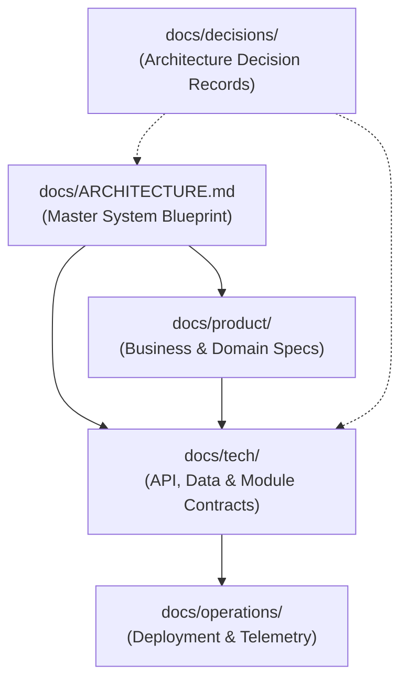

# Documentation System Index & Dependency Map

Scope: Documentation Topology
Related: [System Architecture](ARCHITECTURE.md)

## 1. Responsibilities & Boundaries
This document serves as the single living index and navigation hub for all specifications across the repository.
It catalogs all domain, technical, operational, and architectural documentation leaves to ensure complete discovery and eliminate orphaned specifications.

## 2. Invariants (Hard Rules)
- Every specification file under `docs/` must be cataloged within this index.
- All documentation links within this index must remain valid, relative, and verified.
- This document is maintained programmatically via `python scripts/harness.py index`.
- Manual edits must adhere strictly to the 4-section documentation invariant.

## 3. Specifications & Interfaces

### Documentation Hierarchy

### Specification Catalog

| Specification | Scope | Summary | Related Links |
| :--- | :--- | :--- | :--- |
| [System Architecture & Routing Map](ARCHITECTURE.md) | Global System Topology & Routing | Owns: Root documentation routing map, global architectural topology, cross-domain coordination rules, and overarching sy... | docs/product/overview.md, docs/tech/overview.md |
| [Repository Changelog & Revision Ledger](CHANGELOG.md) | Global Project - Changelist History & Release Notes | Owns: The authoritative living ledger of all versioned changes, feature releases, invariant modifications, and bug fixes... | docs/ARCHITECTURE.md, docs/operations/changelist.md |
| [Architecture Decision Records (ADRs) Guide](decisions/README.md) | Architecture Decision Log & Governance | Owns: Historical repository for all binding architectural, technical, and operational decisions recorded across project ... | docs/ARCHITECTURE.md, docs/tech/overview.md |
| [Changelist & Revision Tracking](operations/changelist.md) | Operations & Lifecycle - Changelist Tracking & Traceability | Owns: Standards, schema contracts, validation rules, and automation workflows for recording and maintaining atomic chang... | docs/ARCHITECTURE.md, docs/CHANGELOG.md, docs/operations/deployment.md |
| [Deployment & Environment Topology](operations/deployment.md) | Operations & Infrastructure - Deployment Lifecycle | Owns: Target environments (local, staging, production), containerization contracts, CI/CD pipeline stages, and secret ma... | docs/ARCHITECTURE.md, docs/operations/telemetry.md |
| [Telemetry, Observability & Health Monitoring](operations/telemetry.md) | Operations & Observability - Logging, Metrics, Tracing & Health | Owns: Structured logging conventions, application metrics collection, distributed tracing propagation, and health check ... | docs/ARCHITECTURE.md, docs/operations/deployment.md |
| [Product Domain Specifications Guide](product/domains/README.md) | Product Strategy - Domain Module Layout | Owns: Directory topology and structural guidance for all functional domain modules placed under docs/product/domains/<do... | docs/product/overview.md, docs/ARCHITECTURE.md |
| [Product Overview & Core Requirements](product/overview.md) | Product Vision & High-Level Requirements | Owns: High-level product definition, user personas, core value propositions, and overarching product requirements. | docs/ARCHITECTURE.md, docs/tech/overview.md |
| [API Protocols & Contracts](tech/api/contracts.md) | Technical Architecture - External & Internal API Layer | Owns: API architectural styles (REST, gRPC, WebSocket), endpoint conventions, URI routing standards, serialization forma... | docs/tech/overview.md, docs/tech/api/error-handling.md |
| [API Error Handling & Resilience Protocols](tech/api/error-handling.md) | Technical Architecture - Error Handling & Resilience Layer | Owns: Standardized error response envelopes, domain error code taxonomies, client retry policies, and circuit breaking c... | docs/tech/overview.md, docs/tech/api/contracts.md |
| [Persistence & Caching Strategy](tech/data/persistence.md) | Technical Architecture - Storage & Caching Layers | Owns: Storage adapters, database connection pooling policies, transaction demarcation, caching strategies, and cache inv... | docs/tech/overview.md, docs/tech/data/schemas.md |
| [Data Schemas & Entities Contract](tech/data/schemas.md) | Technical Architecture - Data Layer & Persistence Models | Owns: Global entity definitions, canonical schema structures, database migration rules, and data transfer object (DTO) c... | docs/tech/overview.md, docs/tech/data/persistence.md |
| [Subsystem Modules Architecture Guide](tech/modules/README.md) | Technical Architecture - Subsystem Modules Topology | Owns: Structural guidance and conventions for technical subsystem designs placed under docs/tech/modules/<module>/. | docs/tech/overview.md, docs/ARCHITECTURE.md |
| [Technical Architecture Overview](tech/overview.md) | Global Technology Stack & Engineering Conventions | Owns: Baseline technology stack selection, cross-cutting architectural patterns, coding conventions, and global technica... | docs/ARCHITECTURE.md, docs/product/overview.md |

## 4. Decisions & Revisions
- 2026-10-24: Auto-generated living documentation index cataloging 14 specification leaves.
